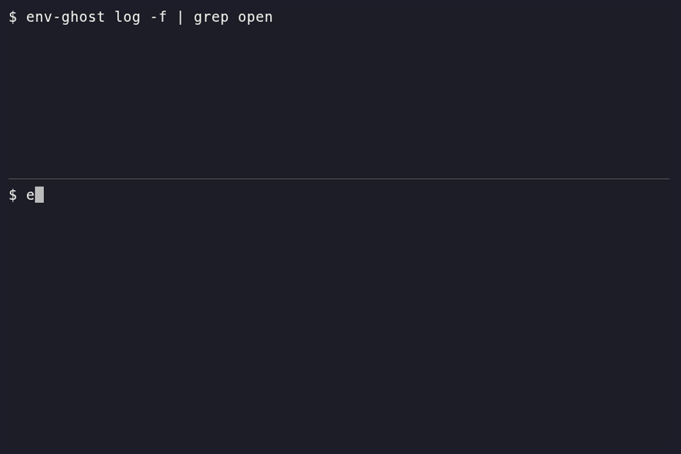

# env-ghost

Caller-aware secrets filesystem for Linux.

[](https://github.com/itsbryanman/envGhost/actions/workflows/ci.yml)
[](LICENSE)
[](Cargo.toml)
[](https://github.com/itsbryanman/envGhost/releases)
[](https://securityscorecards.dev/viewer/?uri=github.com/itsbryanman/envGhost)
[](docs/design.md)
[](docs/design.md)
[](docs/harness-results.md)
[](https://github.com/itsbryanman/envGhost)
[](https://github.com/itsbryanman/envGhost)
[](https://github.com/itsbryanman/envGhost/commits/main)
[](https://github.com/itsbryanman/envGhost/commits/main)
[](https://github.com/itsbryanman/envGhost/issues)
[](https://github.com/itsbryanman/envGhost/pulls)
[](https://github.com/itsbryanman/envGhost/stargazers)

env-ghost mounts FUSE over a single credential file, starting with `.env`.
Every access is tied to the calling process, and each read gets the real
file, a redacted copy with the same keys, prefixes and byte lengths, or a
canary. Package install scripts and AI agent CLIs get the redacted copy by
default. It limits blast radius and leaves a trail. It does not stop
malware, and in this version anything running as your user can unmount it.



## Build

```sh
cargo build --release
./target/release/env-ghost doctor
```

Needs Linux, cgroup v2, `/dev/fuse` and `fusermount3` (package `fuse3`).

## Watch mode

```sh
env-ghost watch .env      # audit only, everyone gets the real file
env-ghost log -f          # in another terminal
cat .env                  # shows up in the log
```

`env-ghost guard .env` serves views by [policy](docs/policy.md).

## More

- [Threat model](docs/threat-model.md)
- [Harness results](docs/harness-results.md)
- [Design](docs/design.md)

## License

Apache-2.0
